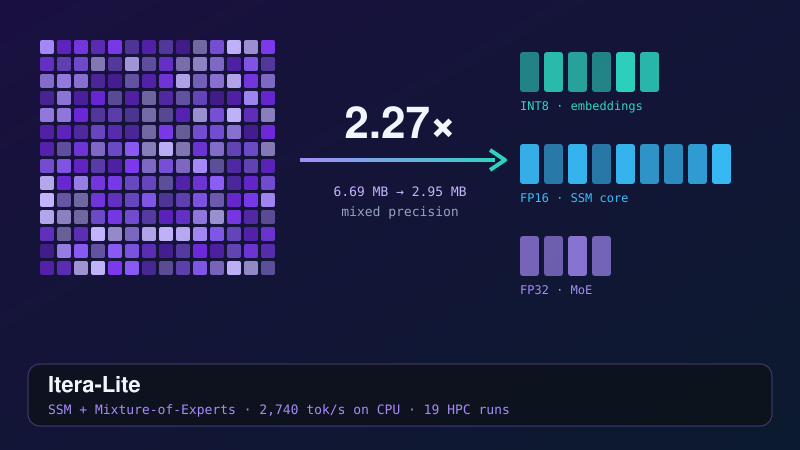
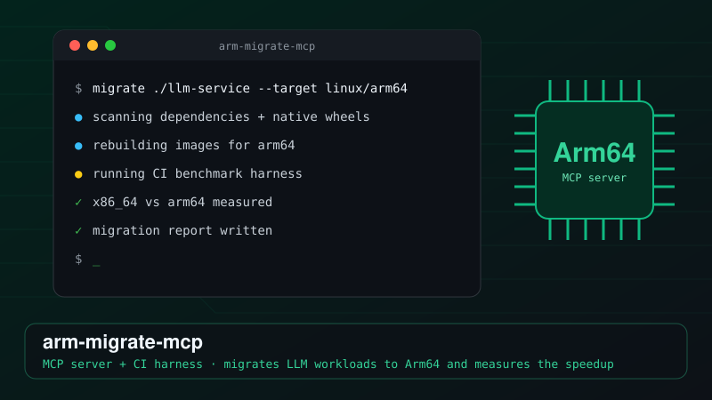
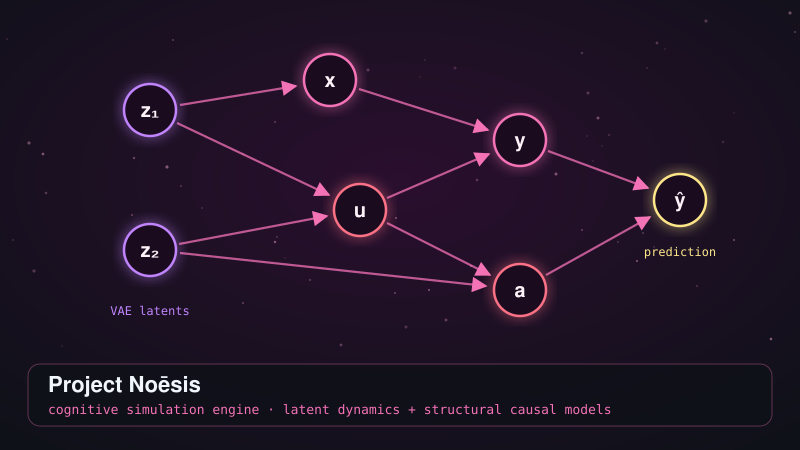
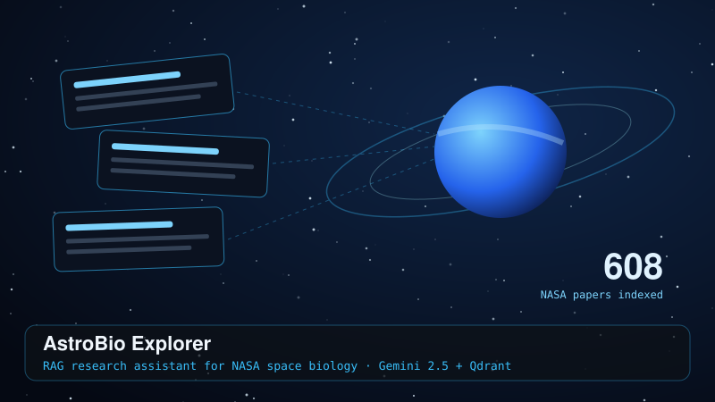

<table>
  <tr>
    <td colspan="2">
      
      
      
      <h3>👋 Hey! Nice to meet you</h3>
      CS @ Texas A&amp;M University–San Antonio · building <a href="https://synthiq.app">Synthiq</a> · efficient AI, agent simulations, AI + security
    </td>
  </tr>
  <tr>
    <td width="50%"></td>
    <td width="50%"></td>
  </tr>
  <tr>
    <td width="50%"></td>
    <td width="50%"></td>
  </tr>
  <tr>
    <td colspan="2">
      <b>languages</b> 
      
      
      
      
      
      
    </td>
  </tr>
  <tr>
    <td colspan="2">
      <b>ml / research</b> 
      
      
      
      
      
      
    </td>
  </tr>
  <tr>
    <td colspan="2">
      <b>agents / ai</b> 
      
      
      
      
      
      
    </td>
  </tr>
  <tr>
    <td colspan="2">
      <b>infra</b> 
      
      
      
      
      
      
    </td>
  </tr>
</table>
