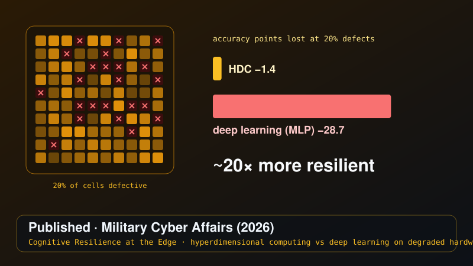
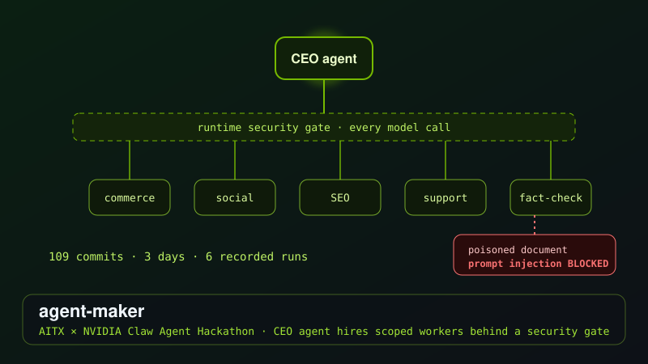
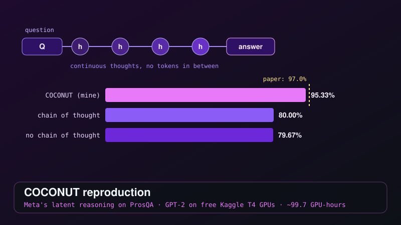
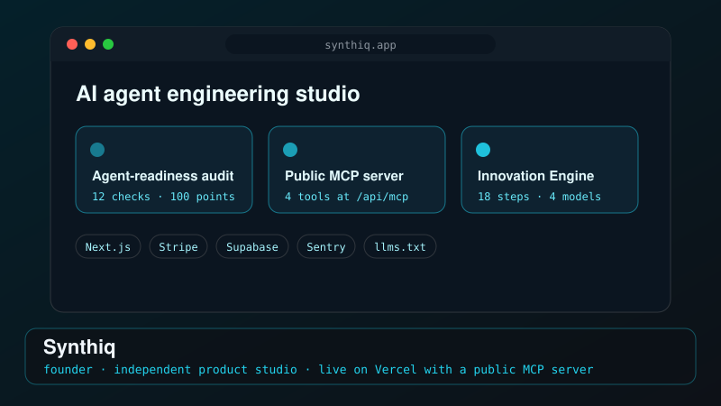
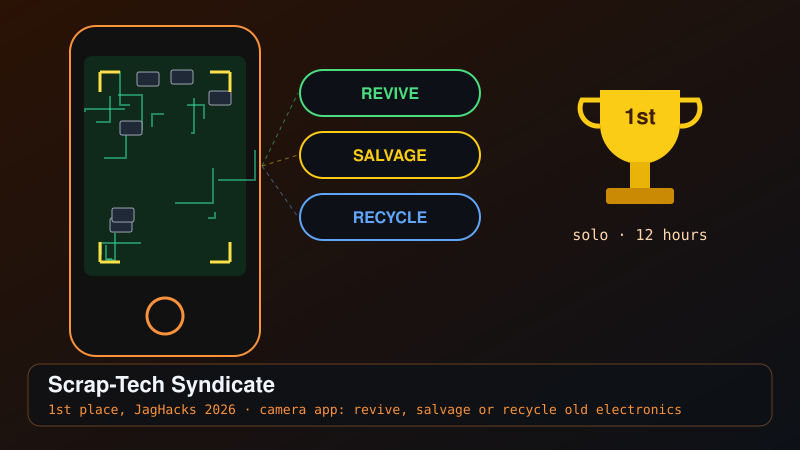

<table>
  <tr>
    <td colspan="2">
      
      
      
      <h3>👋 Hey! Nice to meet you</h3>
      CS @ Texas A&amp;M University–San Antonio · founder of <a href="https://synthiq.app">Synthiq</a> · VICEROY Cybersecurity Scholar · <a href="https://adriancisneros.dev">adriancisneros.dev</a>
    </td>
  </tr>
  <tr>
    <td width="50%"></td>
    <td width="50%"></td>
  </tr>
  <tr>
    <td width="50%"></td>
    <td width="50%"></td>
  </tr>
  <tr>
    <td width="50%"></td>
    <td width="50%"></td>
  </tr>
  <tr>
    <td colspan="2">
      <b>highlights</b> 
      
      📄 Published in <i>Military Cyber Affairs</i>, Vol. 9, Iss. 1 · <a href="https://github.com/CisnerosCodes/VICEROY_2026_HDC_Sim">code</a> 
      🎤 Presenter, Stars track, HammerCon 2026 (Johns Hopkins APL) 
      🥈 2nd place, student research poster competition, VICEROY Symposium, William &amp; Mary 
      🏆 1st place, JagHacks 2026 hackathon (built solo) 
      🛰️ Software engineering intern with a U.S. Air Force electronic warfare squadron (summer 2026) 
      🔐 CompTIA Security+ (SY0-701)
      
    </td>
  </tr>
  <tr>
    <td colspan="2">
      <b>languages</b> 
      
      
      
      
      
      
      
    </td>
  </tr>
  <tr>
    <td colspan="2">
      <b>ai / research</b> 
      
      
      
      
      
      
      
    </td>
  </tr>
  <tr>
    <td colspan="2">
      <b>agents / llm</b> 
      
      
      
      
      
      
      
    </td>
  </tr>
  <tr>
    <td colspan="2">
      <b>web / backend</b> 
      
      
      
      
      
      
      
      
    </td>
  </tr>
  <tr>
    <td colspan="2">
      <b>infra</b> 
      
      
      
      
      
      
      
    </td>
  </tr>
  <tr>
    <td colspan="2">
      <b>security</b> 
      
      
      
      
      
      
      
    </td>
  </tr>
</table>
